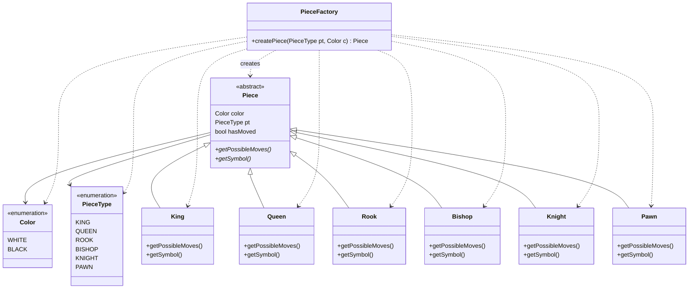
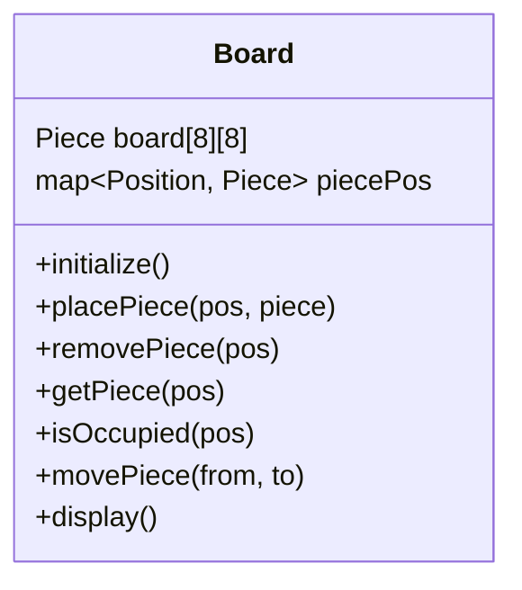

## Requirements
- We can have multiple users playing chess at the same time.
- Score based match making algorithm(same level people pay together)
- We have standard chess rules but can be scale-able
- User within a match can also send/receive messages(mediator design pattern)
- User can quit the match in between(change points).
## Happy flow
user comes to our platform and request for a match.
![[Pasted image 20261128112923.png]]
put user in waiting to get a match.
if similar level of `u1` and `u2`.
![[Pasted image 20261128113819.png]] (CR=> chat room)
need to make chess, chat room and match making.
## UML
will do top-down as game works better with bigger component first.
main object will orchestration singleton class `GameManager`.
will have many matches(as many matches happening at same time) => match id and match => ![[Pasted image 20261128115808.png]]
for a match will have id, user(only 2 can make it scale-able) => black user and white user.
now for user.
![[Pasted image 20261128120921.png]]
user can have name and score also ![[Pasted image 20261128125043.png]]
match has 2 users.![[Pasted image 20261128125100.png]]
need to make mediator for chat room => `gameManager` can't be mediator as it manages multiple games.
thus, match will become mediator.
will make mediator and colleague.
user is a colleague and match is mediator.
message will be a class.
![[Pasted image 20261128125847.png]] => for add and remove user need to have only 2 user.
![[Pasted image 20261128164713.png]]
need a board with all pieces.
will have 2D array of a\[8]\[8] => will have world have a chess piece.
need to have piece class.
a piece has => color(Enum `BLACK` or `WHITE`), piece type, ![[Pasted image 20261128165724.png]], `hasmoved`(in started position as pawn need to keep first move as first move is 1 or 2 and rest is 1 move), `getPossibleMoves()`, `getSymbol()`.
![[Pasted image 20261128165922.png]]
will have many concert piece.
have a piece factory to make pieces.

board has set or pieces => need to know in O(1) where is piece use map.
position => ![[Pasted image 20261128170709.png]]

